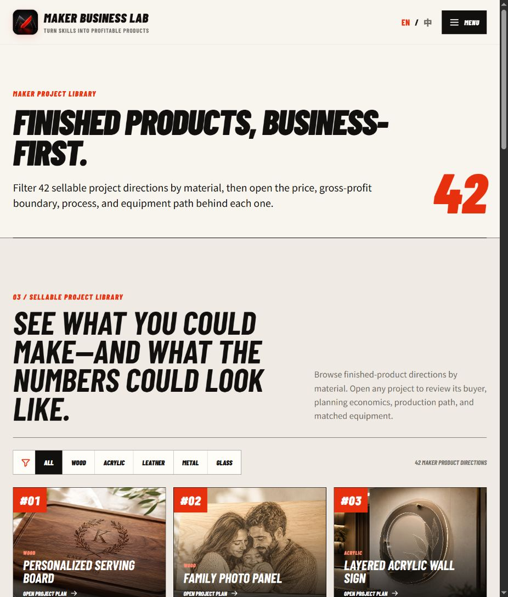
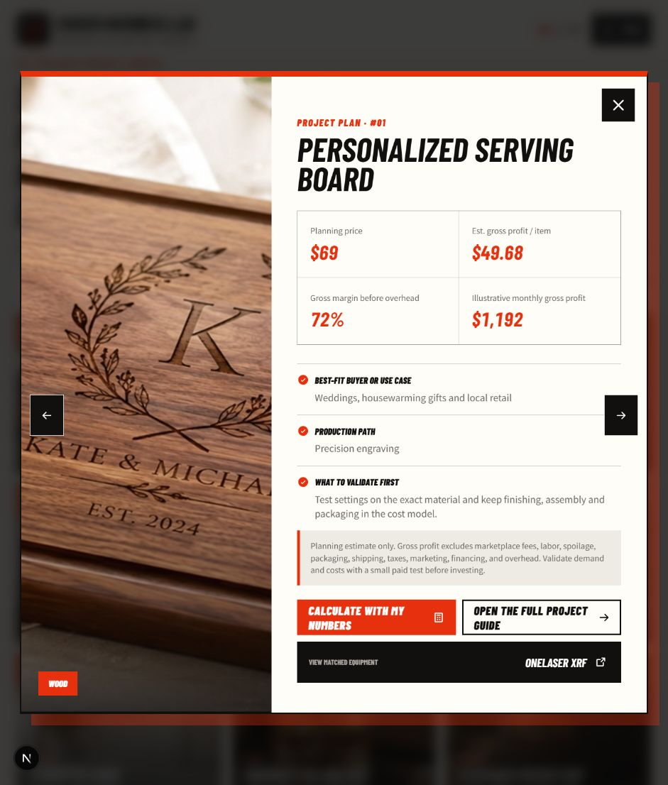
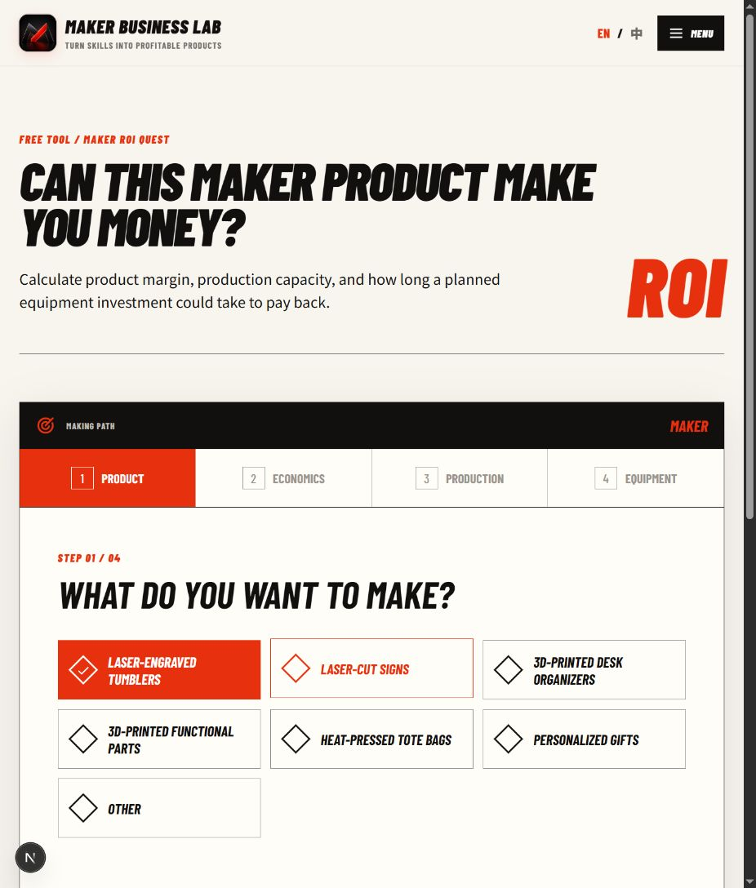
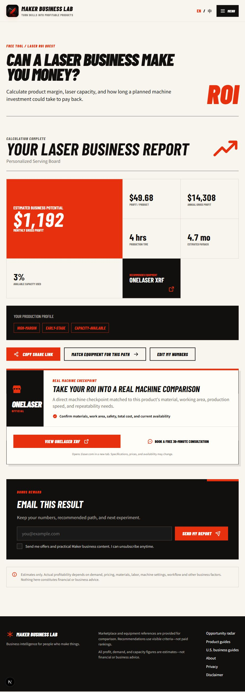
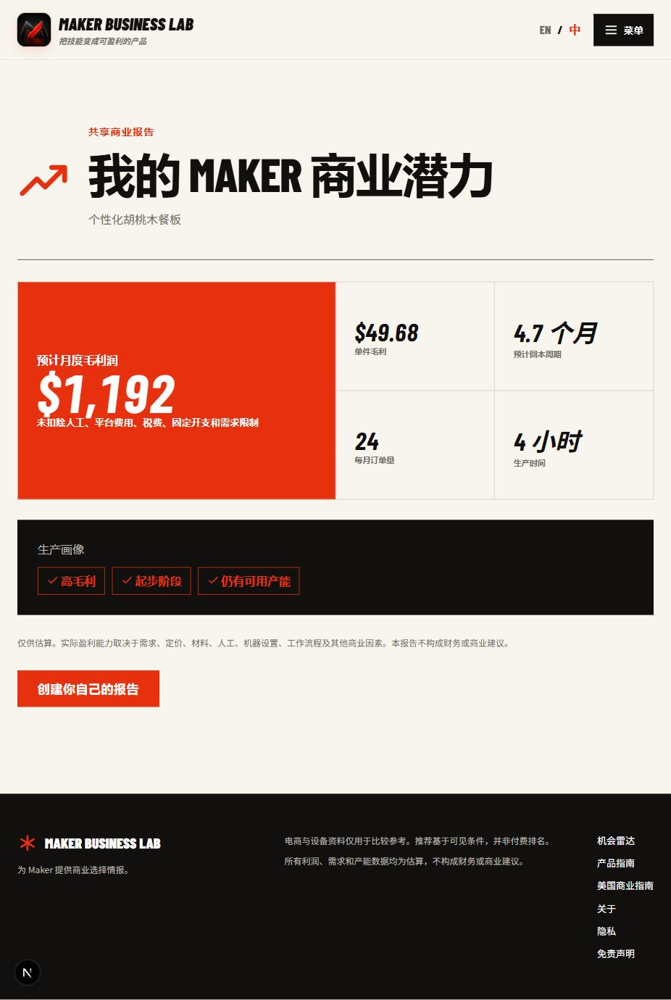
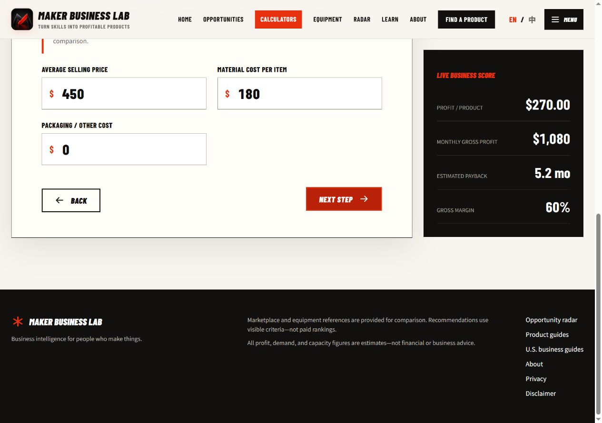

# PC UX review and Mac handoff — 2026-10-13

Base: `origin/main` at `b68eb8753a678599a986f6f39c3386ab04d76fcf`.
Branch: `codex/pc-ux-improvements`, created in an isolated worktree.

## Scope and outcome

Reviewed the project library → project plan → ROI calculator → report flow,
using the current local code and its static export. This is a focused review,
not a claim that every site route or accessibility requirement was audited.

The library has useful material filters, explicit planning assumptions, and
clear links to process and equipment. The main defect was the calculator
handoff: the $69 serving-board plan opened a generic calculator with a tumbler
selection, $35 selling price, and $25 per-item profit.

## Steps and evidence

1. **Browse projects — healthy.** Material filters and project cards are clear.
   Filtered counts now have a status announcement.
   
2. **Open a project plan — healthy presentation, broken handoff fixed.** The
   serving-board plan has a $69 price and $49.68 illustrative per-item profit.
   All calculator links in the modal and full guide now carry the project slug.
   
3. **Start the calculator — previously incorrect, now fixed.** The original
   calculator discarded the project and selected tumblers. It now selects the
   serving board, keeps its planning price and order volume, and explains the
   inferred material cost, zero packaging placeholder, and generic production
   and investment defaults. Product selection and the current step have ARIA
   state attributes. Changing products deliberately preserves entered numbers.
   
   
4. **Generate and share the report — healthy in the tested flow.** Four-step
   navigation, editing, copied share links, and the Chinese project title were
   checked. The serving-board report shows $49.68 per item, $1,192 rounded
   monthly profit, and OneLaser XRF. Switching a batch-tumbler calculation to
   Signs changes the equipment to Cobra 10 and retains the entered numbers.
   
   
5. **Use the calculator on a phone — cramped result units fixed.** At a
   390×844 viewport, stacked metric labels and values keep “4.7 个月” together.
   The final static page has no horizontal overflow (375px content width and
   375px scroll width with the browser scrollbar). The screenshot below comes
   from the final static export, without development tools.
   
6. **Check the exported site — healthy in the tested flow.** Served `out/`
   locally at port 3001. Event Tumbler Batch starts at $450/$180 and four
   monthly batches; editing price to $475 yields $295 per item and $1,180 per
   month, with VertiGo links in both equipment placements. Existing heat-press
   opportunity links still select the correct method. Unknown/inherited query
   names fall back to the generic calculator; no console errors/warnings were
   observed in this static browser run.
   

## Validation

| Check | Result |
| --- | --- |
| `pnpm install --frozen-lockfile` | Pass; lockfile unchanged |
| `pnpm test` | Pass: 26 files, 106 tests, including 5 new handoff tests |
| `pnpm run typecheck` | Pass |
| `pnpm run lint` | Pass |
| `pnpm run build:pages` | Pass: 144 generated static pages |
| `git diff --check` | Pass |
| Browser checks | Desktop, Chinese mobile, modal/full-guide links, four steps, edited report, sharing, product switching, existing product URLs, invalid-query fallback |

`build:pages` now uses a Node launcher to set the same site URL on Windows,
macOS, and Linux, without adding a dependency or changing deployment settings.
The checks above ran on Windows; macOS execution remains for the reviewer.

## Next improvements and limits

- Improve number editing: clearing a numeric input immediately becomes zero.
  This was reproduced in the browser and confirmed in `NumberField`. A later
  change should preserve an editing draft and provide clear range validation.
- Extend unit economics to optional labor, platform fees, spoilage, and shipping.
  Current screens state exclusions; the present model does not estimate net profit.
- Add `build:pages` to the PR verification job. Currently the workflow runs that
  script only in the main-branch deployment job, so this PR's static-export
  verification was performed locally.

No real email was submitted, no equipment purchase was attempted, and no
screen-reader, iOS Safari, or full WCAG compliance claim is made. Project
material costs are inferred planning values, not verified supplier quotes;
production times and equipment investment remain editable generic defaults.

## Mac review

Check out this PR branch, run the frozen-lockfile install and the four requested
checks, then review serving-board and event-tumbler project handoffs in English
and Chinese on Safari. Review the supplied screenshots and the estimate note.
Merge and production release remain the Mac reviewer's separate actions.
